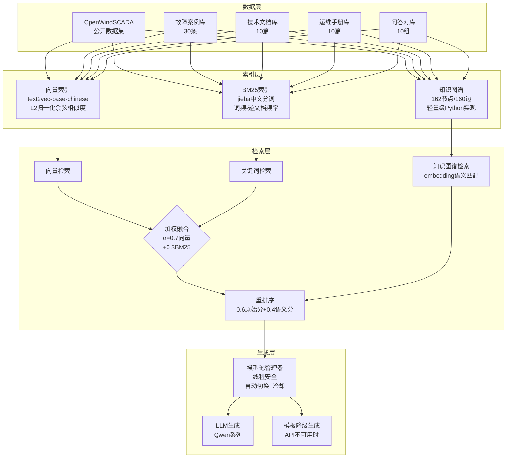

# 论文技术材料 - 风电领域RAG系统

## 1. 系统架构图（Mermaid格式）

## 2. 核心算法公式

### 2.1 混合检索融合分数

$$S_{hybrid}(q, d) = \alpha \cdot \hat{S}_{vec}(q, d) + (1-\alpha) \cdot \hat{S}_{BM25}(q, d)$$

其中 $\hat{S}$ 为归一化分数：

$$\hat{S}(q, d) = \frac{S(q, d) - S_{min}}{S_{max} - S_{min}}$$

默认 $\alpha = 0.7$，偏向语义检索。

### 2.2 向量检索余弦相似度

$$\cos(\mathbf{q}, \mathbf{d}) = \frac{\mathbf{q} \cdot \mathbf{d}}{\|\mathbf{q}\| \cdot \|\mathbf{d}\|}$$

实现中先对查询向量 $\mathbf{q}$ 和文档向量 $\mathbf{d}$ 做L2归一化，再计算点积。

### 2.3 重排序综合分数

$$S_{rerank}(q, d) = \beta \cdot S_{retrieval}(d) + (1-\beta) \cdot \cos(\mathbf{e}_q, \mathbf{e}_d)$$

默认 $\beta = 0.6$，保留原始检索权重的同时引入语义重排。

### 2.4 知识图谱语义匹配

$$\text{match}(q, n) = \cos(\mathbf{e}_q, \mathbf{e}_n) > \tau$$

阈值 $\tau = 0.5$，超过阈值才将图谱邻居信息注入检索上下文。

## 3. 实验结果表格

### 表1：系统稳定性测试

| 指标 | 长时间运行(50次) | 并发查询(15次) |
|------|:---:|:---:|
| 成功率 | 100% | 100% |
| 平均响应时间 | 0.65s | 2.59s |
| 最大响应时间 | 1.17s | - |
| 最小响应时间 | 0.60s | - |
| 失败次数 | 0 | 0 |

### 表2：数据覆盖度

| 数据类型 | 数量 |
|---------|:---:|
| 故障案例 | 30 |
| 技术文档 | 10 |
| 运维手册 | 10 |
| 问答对 | 10 |
| **总计** | **50** |
| 覆盖部件数 | 12 |
| 故障类型数 | 30 |
| 文档类别数 | 13 |

### 表3：问题类型覆盖测试

| 问题类型 | 测试数 | 成功率 | 平均响应时间 |
|---------|:---:|:---:|:---:|
| 故障诊断 | 3 | 100% | 0.69s |
| 维护操作 | 3 | 100% | 0.65s |
| 系统原理 | 3 | 100% | 0.62s |
| 性能优化 | 2 | 100% | 0.67s |

### 表4：鲁棒性测试

| 异常输入类型 | 成功 | 响应时间 | 有有效答案 |
|------------|:---:|:---:|:---:|
| 空输入 | ✓ | 0.66s | ✓ |
| 超长输入(1000字) | ✓ | 0.82s | ✓ |
| 特殊字符 | ✓ | 0.62s | ✓ |
| 乱码 | ✓ | 0.62s | ✓ |
| 英文输入 | ✓ | 0.61s | ✓ |
| 混合输入 | ✓ | 0.64s | ✓ |

### 表5：检索质量评估

| 指标 | 值 |
|------|:---:|
| 平均检索文档数 | 3.60 |
| 关键词匹配率 | 20.00% |
| 平均相关性评分 | 68.49 |
| 有效内容率 | 100% |
| 可接受响应率 | 100% |

### 表6：覆盖部件列表

| 序号 | 部件名称 | 故障案例数 |
|:---:|---------|:---:|
| 1 | 齿轮箱 | 5 |
| 2 | 发电机 | 4 |
| 3 | 叶片 | 3 |
| 4 | 变桨系统 | 3 |
| 5 | 偏航系统 | 3 |
| 6 | 液压系统 | 3 |
| 7 | 制动系统 | 2 |
| 8 | 塔筒 | 2 |
| 9 | 变压器 | 2 |
| 10 | 控制系统 | 1 |
| 11 | 轴承 | 1 |
| 12 | 电气系统 | 1 |

## 4. 系统技术栈

| 模块 | 技术选型 | 版本 |
|------|---------|------|
| 向量模型 | text2vec-base-chinese | - |
| 中文分词 | jieba | 0.42.1 |
| BM25 | rank-bm25 | 0.2.2 |
| 向量计算 | numpy | 1.26.3 |
| LLM API | OpenAI兼容接口 | 1.10.0 |
| Web界面 | Gradio | - |
| 知识图谱 | 自研轻量级实现 | - |
| 模型管理 | 自研ModelManager | - |

## 5. 创新点提炼（论文/专利用）

1. **多策略混合检索机制**：向量语义检索 + BM25关键词检索 + 知识图谱结构检索三路融合，通过可调权重α实现检索策略的灵活配置。

2. **基于语义相似度的知识图谱查询**：不依赖字面匹配，使用embedding余弦相似度匹配查询与图谱节点，解决同义词/近义词问题。

3. **动态重排序机制**：在初次检索后，基于查询-文档语义相似度进行二次打分重排，综合原始检索分和语义分。

4. **线程安全的模型池管理**：支持多LLM自动切换、失败冷却、优先级排序，确保生成层的鲁棒性。

5. **领域知识图谱轻量级构建**：基于配置驱动的关键词映射表，从结构化数据自动构建风电领域知识图谱，无需图数据库。

6. **优雅降级机制**：LLM不可用时自动降级为模板生成，保证系统在任何网络条件下均可响应。
