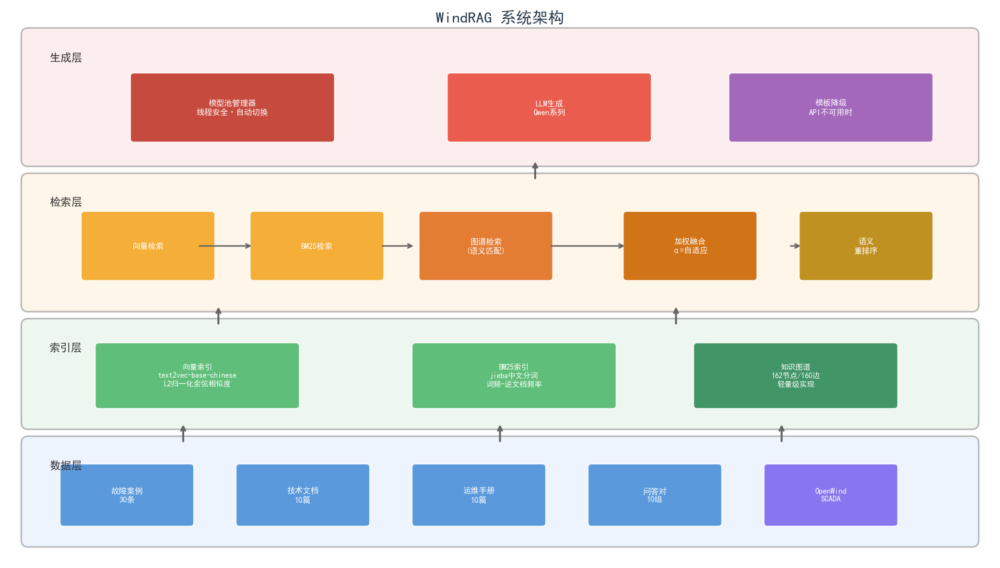
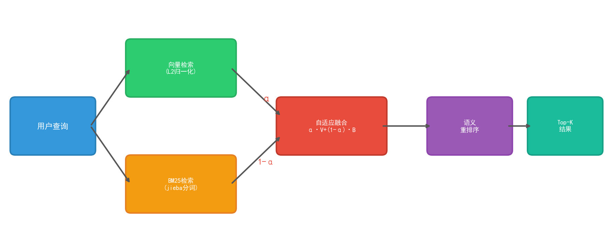
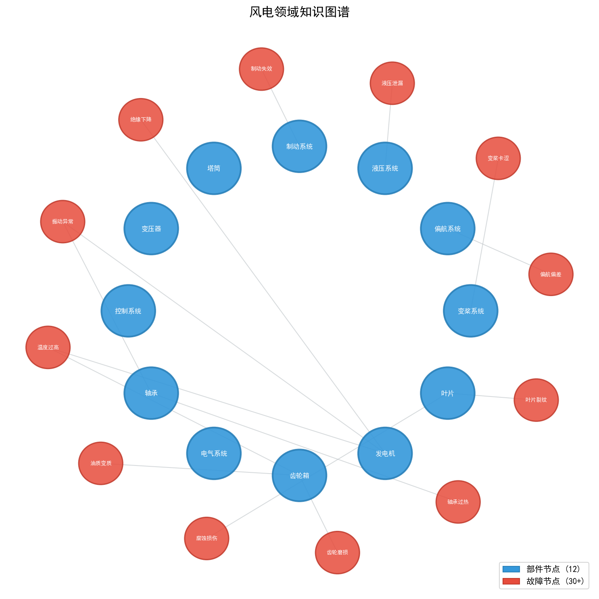
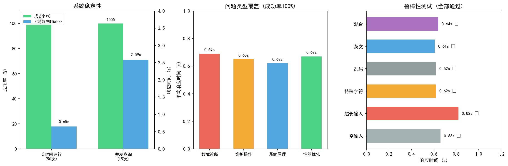
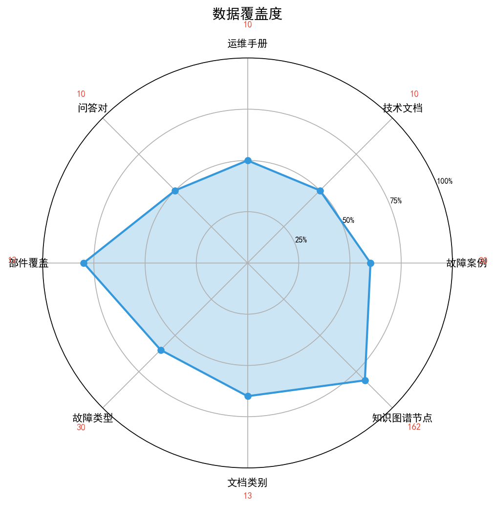
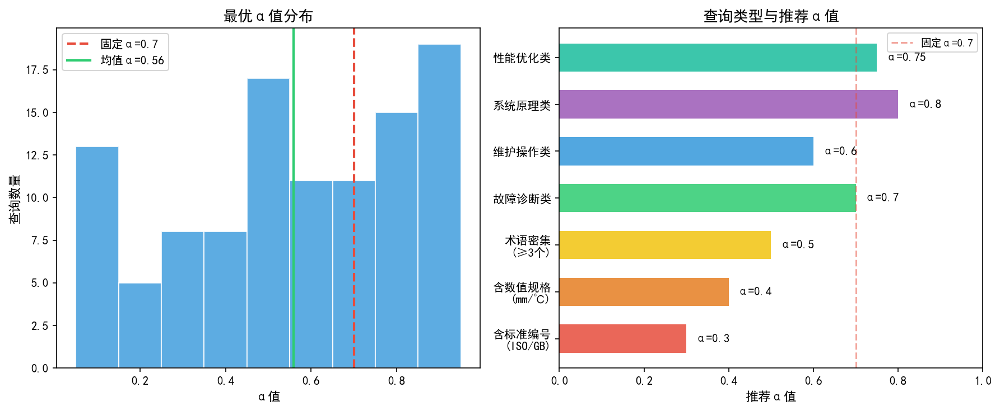

<div align="center">

# 🌬️ WindRAG

**风电领域智能诊断问答系统 — 基于多策略混合检索与知识图谱增强的RAG**

[](https://www.python.org/)
[](LICENSE)
[]()
[]()

</div>

---

## 📖 项目简介

WindRAG 是一个面向风力发电领域的智能故障诊断问答系统，采用**检索增强生成（RAG）**架构，融合向量语义检索、BM25关键词检索和知识图谱结构检索三种策略，实现高质量的风电领域知识问答。

### ✨ 核心特性

- 🔀 **自适应混合检索** — 根据查询特征动态调整向量检索与BM25检索的融合权重
- 🕸️ **知识图谱增强** — 基于embedding语义匹配的知识图谱查询，解决同义词问题
- 🔄 **模型池管理** — 线程安全的多LLM自动切换，支持失败冷却与优雅降级
- 🇨🇳 **中文深度优化** — jieba分词、中文向量模型、领域术语识别
- 🛡️ **高鲁棒性** — 异常输入、并发查询、LLM不可用等场景全部测试通过

---

## 🏗️ 系统架构



系统采用四层架构设计：

| 层级 | 功能 | 关键技术 |
|:---:|------|---------|
| 数据层 | 多源异构数据整合 | 故障案例/技术文档/运维手册/问答对 |
| 索引层 | 三种互补索引 | 向量索引 · BM25索引 · 知识图谱 |
| 检索层 | 多策略融合检索 | 自适应α融合 · 语义重排序 · 图谱增强 |
| 生成层 | 鲁棒答案生成 | 模型池管理 · LLM生成 · 模板降级 |

---

## 🔀 检索流程



### 自适应融合公式

$$S_{hybrid}(q, d) = \alpha \cdot \hat{S}_{vec}(q, d) + (1-\alpha) \cdot \hat{S}_{BM25}(q, d)$$

其中 $\alpha$ 不再是固定值，而是根据查询特征**动态预测**：

| 查询特征 | 推荐α值 | 含义 |
|---------|:---:|------|
| 含标准编号 (ISO/GB) | 0.3 | BM25精确匹配更重要 |
| 含数值规格 (mm/℃) | 0.4 | 精确数值检索更关键 |
| 术语密集 (≥3个) | 0.5 | BM25召回效果好 |
| 维护操作类 | 0.6 | 语义+关键词均衡 |
| 故障诊断类 | 0.7 | 语义理解更重要 |
| 性能优化类 | 0.75 | 语义理解为主 |
| 系统原理类 | 0.8 | 纯语义理解 |

---

## 🕸️ 知识图谱



- **162个节点**：12个部件节点 + 30+故障节点 + 维护操作节点
- **160条边**：`HAS_FAULT`（部件→故障）+ `REQUIRES`（部件→维护操作）
- **语义查询**：基于embedding余弦相似度匹配，阈值τ=0.5

---

## 📊 实验结果



### 系统稳定性

| 指标 | 长时间运行(50次) | 并发查询(15次) |
|------|:---:|:---:|
| 成功率 | **100%** | **100%** |
| 平均响应时间 | 0.65s | 2.59s |

### 鲁棒性测试

| 异常输入类型 | 成功 | 响应时间 |
|------------|:---:|:---:|
| 空输入 | ✓ | 0.66s |
| 超长输入 | ✓ | 0.82s |
| 特殊字符 | ✓ | 0.62s |
| 乱码 | ✓ | 0.62s |
| 英文输入 | ✓ | 0.61s |
| 混合输入 | ✓ | 0.64s |

### 数据覆盖度



| 数据类型 | 数量 |
|---------|:---:|
| 故障案例 | 30 |
| 技术文档 | 10 |
| 运维手册 | 10 |
| 问答对 | 10 |
| 覆盖部件 | 12 |
| 故障类型 | 30 |
| 知识图谱节点 | 162 |

### 自适应α分布



---

## ⚡ 零依赖纯 Python 检索内核

`sentence-transformers` 会连带安装 PyTorch（约 2GB），`rank-bm25`、`gradio` 等也都是外部依赖。
为此项目在 `src/pure_rag/` 下另外实现了一套**只用 Python 标准库**的检索内核，与重依赖版并存，
两者共用同一份数据与知识图谱：

| 能力 | 常依赖版 | 纯 Python 版 |
|------|---------|-------------|
| 中文分词 | jieba | 领域词典 + 正向最大匹配 + 二元组，并可无监督发现新词 |
| 关键词检索 | rank-bm25 | 手写 Okapi BM25（倒排表 + 平滑 IDF） |
| 语义检索 | text2vec-base-chinese（768 维） | 手写 TF-IDF 稀疏向量 + 倒排索引 + 余弦相似度 |
| 融合权重 | MLP + 规则先验 | 规则先验自适应 α + RRF 多路合并 + MMR 多样性重排 |
| 知识图谱 | embedding 余弦匹配 | TF-IDF 语义匹配 + 同义词表（解决"变速箱 → 齿轮箱"） |
| 答案生成 | LLM API | 抽取式摘要（默认），可选 LLM（标准库 urllib 直连） |
| 数据导入 | 需自行扩展 | 自动纳入 `data/user_docs/` 的 txt / md / json / csv / **docx**（zipfile 解析），支持 `add` 增量追加 |
| 结果展示 | 纯文本 | 命中词字符级高亮（终端 ANSI / Web `<mark>` / 记录 Markdown 加粗） |
| 引用定位 | 无 | 答案每条要点带 `doc_id` + 字符区间，Web 上点击即跳到原文该句 |
| 结构化输出 | 无 | 检索到故障案例时输出「症状 / 原因 / 诊断 / 解决方案 / 预防措施」卡片 |
| 打分明细 | 无 | `explain` 展示每个查询词对 BM25 / TF-IDF 得分的贡献 |
| 参数调优 | 手工 | `tune` 网格搜索分块与融合参数并落盘生效 |
| 评测集 | 15 条 QA | **114 条分层评测集**（7 层）：由语料自动推导、确定性构建、一键出报告 |
| 消融实验 | 仅研究版内部 | `ablation` 逐项开关模块并输出对比表（含固定 α 扫描与负面结果） |
| 对话记录 | 无 | `chat` 的 `/save` 或 `--log` 导出带来源的 Markdown 记录 |
| 拒答 | 无 | 置信度不足时明确回「知识库没有相关资料」，阈值可标定（`eval --negative`） |
| 持续集成 | 无 | `.cnb.yml`：PR 与 main 自动跑单测 + 评测，Recall 低于 0.9 直接失败 |
| Web 界面 | Gradio | `http.server` 单页应用 |
| 第三方依赖 | 10+ 个包 | **0 个** |

### 用法（无需安装任何依赖）

```bash
python src/rag_cli.py build                        # 构建索引（分词 + BM25 + TF-IDF + 新词发现）
python src/rag_cli.py add 新资料.docx               # 增量追加（不重建整个索引）
python src/rag_cli.py ask "齿轮箱温度过高应该怎么处理？" --show-docs
python src/rag_cli.py chat --log                   # 交互式多轮问答，退出时自动导出记录
python src/rag_cli.py explain "变速箱异响怎么排查？"  # 查看逐词打分明细
python src/rag_cli.py eval -n 15 --robust          # 自召回 + 改写查询鲁棒性评测
python src/rag_cli.py eval --negative              # 拒答能力评测 + 阈值标定表
python src/rag_cli.py eval --report                # 分层评测报告（落盘 report.md + report.json）
python src/rag_cli.py --min-coverage 0 ask "..."   # 临时关闭拒答（默认阈值 0.35）
python src/rag_cli.py tune --quick                 # 网格搜索最优参数（去掉 --quick 为完整网格）
python src/rag_cli.py ablation                     # 消融实验表（各模块贡献 + 固定 α 扫描）
python src/rag_cli.py stats                        # 索引统计
python src/rag_cli.py serve --port 8000            # 零依赖 Web 界面
```

把自有资料（含 Word 文档）放进 `data/user_docs/` 后重新 `build` 即可被检索到；也可以直接
`add 文件/目录` 增量入库（只对新增文档分块分词，旧文档复用持久化的词序列）。

`ask --show-docs` 除了高亮命中词，还会打印每条要点在原文中的位置：

```
要点定位（原文中的字符区间）：
  1. doc35（qa_pairs/故障诊断）字符 22–62
  2. doc5（fault_cases/齿轮箱）字符 28–50
```

Web 界面上这些要点可直接点击，跳转并高亮对应的来源文档；问故障类问题时还会额外渲染
「症状 / 原因 / 诊断 / 解决方案 / 预防措施」卡片。

作为库调用：

```python
import sys; sys.path.insert(0, "src")
from pure_rag import RAGEngine

engine = RAGEngine(use_llm=False)
result = engine.query("齿轮箱温度过高应该怎么处理？")
print(result["answer"])
for doc in result["retrieved_docs"]:
    print(doc["score"], doc["matched"], doc["metadata"]["title"])   # matched 为命中词
```

测试与索引文件：

```bash
python -m unittest tests.test_pure_rag -v     # 98 项单元测试
```
`data/pure_index/` 下为 `documents.json`（分块）、`tokens.json`（词序列缓存）、`bm25.json`、
`tfidf.json`、`meta.json`、`tuning.json`，全部可重新生成，已加入 `.gitignore`。

### 评测结果（114 条分层评测集 / 66 篇文档 → 70 个分块）

| 指标 | 数值 |
|------|------|
| Recall@3（回答层 80 条） | **100%** |
| MRR / nDCG@3（回答层 80 条） | 0.9667 / 0.9753 |
| └ QA 原句（15 条） | 100% / MRR 0.8889 |
| └ 同义改写（15 条） | 100% / MRR 0.9333 |
| └ 故障案例查询（30 条） | 100% / MRR 1.0000 |
| └ 文档标题查询（20 条） | 100% / MRR 1.0000 |
| 拒答率（域外问题 10 条） | **100%** |
| 拒答率（近邻负例 18 条） | 5.56% ← 见下方已知边界 |
| 拒答率（域内缺资料 6 条） | 16.67% |
| 答案领域术语覆盖率 | 70.07% |
| 平均检索耗时（含高亮定位） | 0.5 ms |
| 索引构建耗时 | 0.06 s |
| 单元测试 | 98 项全部通过 |

### 分层评测集

`python src/rag_cli.py eval --report` 会生成一份**可复现的分层评测报告**
（`data/pure_index/report.md`，同名 `.json` 供后续对比）。评测集由语料自动推导、**无需人工标注**，
因此能随语料一起演进；确定性构建保证任何人跑出同样的 114 条：

| 层 | 来源 | 条数 | 目标定位方式 |
|---|---|---|---|
| `qa_verbatim` | QA 对原句 | 15 | 该问题所在块（按问题文本） |
| `qa_rewrite` | 原句的同义改写（齿轮箱 → 变速箱） | 15 | 同上的块 |
| `fault_case` | 故障案例「部件 + 故障类型」 | 30 | 该案例块（按故障 ID） |
| `doc_title` | 技术文档 / 运维手册标题 | 20 | 该文档的任意块（按 source + title） |
| `near_miss` | 语料中不存在的「部件 × 故障」组合 | 18 | 无（期望严格拒答） |
| `negative_ood` | 域外问题 | 10 | 无 |
| `negative_missing` | 域内但缺资料 | 6 | 无 |

`--rebuild` 可重新生成（语料变了就该重建），报告里会写明日志：

```
- 生成时间：2026-10-16 14:41:54
- 检索引擎：纯 Python 内核 v1.0.0（零第三方依赖，Python 3.12.15）
- 语料：66 篇 → 70 个分块，词表 1747 词
- 评测集：114 条（7 层，由语料自动推导）
- 参数：top_k=3、method=hybrid、融合权重 α 自适应、拒答阈值 0.35
```

### 消融实验

`python src/rag_cli.py ablation` 逐项开关各模块（每组配置都在独立目录重建索引后，
在 114 条分层评测集上评测，1.3 秒跑完）：

| 配置 | 说明 | Recall@k | 改写召回 | 案例召回 | MRR | 术语覆盖率 | 域外拒答 | 近邻拒答 | 耗时 |
|---|---|---|---|---|---|---|---|---|---|
| ① 仅 BM25 | 关键词检索基线 | 98.75% | 93.33% | 100.00% | 0.9583 | 63.04% | 100.00% | 0.00% | 0.53 ms |
| ② 仅 TF-IDF 向量 | 语义检索基线 | 98.75% | 93.33% | 100.00% | 0.9333 | 66.43% | 100.00% | 0.00% | 0.48 ms |
| ③ 混合 · 固定 α=0.7 | 两路加权融合 | 98.75% | 93.33% | 100.00% | 0.9521 | 65.69% | 100.00% | 0.00% | 0.47 ms |
| ④ + 自适应 α | 按查询特征预测权重 | 98.75% | 93.33% | 100.00% | 0.9521 | 63.78% | 100.00% | 0.00% | 0.50 ms |
| ⑤ + 同义词打通 | 索引期标准词↔别名扩展 | **100.00%** | **100.00%** | 100.00% | **0.9729** | 61.61% | 100.00% | 5.56% | 0.56 ms |
| ⑥ + 查询扩展 | 别名/关键词变体多路召回 + RRF | 100.00% | 100.00% | 100.00% | 0.9667 | 61.61% | 100.00% | 5.56% | 0.62 ms |
| ⑦ + MMR 重排 | 抑制内容重复的文档 | 100.00% | 100.00% | 100.00% | 0.9667 | 61.61% | 100.00% | 5.56% | 0.79 ms |
| ⑧ + 知识图谱（完整） | 图谱上下文并入答案 | 100.00% | 100.00% | 100.00% | 0.9667 | **70.07%** | 100.00% | 5.56% | 0.81 ms |
| ⑨ 完整 − 新词发现 | 对照：关闭语料新词发现 | 100.00% | 100.00% | 100.00% | **1.0000** | 64.82% | 100.00% | 5.56% | 1.07 ms |

固定 α 扫描（只变 α，其余固定为「同义词 + 无扩展 + 无 MMR + 无图谱」）：

| 配置 | Recall@k | 改写召回 | MRR | 术语覆盖率 | 域外拒答 | 近邻拒答 |
|---|---|---|---|---|---|---|
| α = 0.3 / 0.4 | 100.00% | 100.00% | **0.9938** | 59.71% | 100.00% | 5.56% |
| α = 0.5 | 100.00% | 100.00% | 0.9875 | 60.45% | 100.00% | 5.56% |
| α = 0.6 | 100.00% | 100.00% | 0.9729 | 59.71% | 100.00% | 5.56% |
| α = 0.7 / 0.8 | 100.00% | 100.00% | 0.9667 | 61.61% | 100.00% | 5.56% |
| **α = 自适应（默认）** | 100.00% | 100.00% | 0.9729 | 61.61% | 100.00% | 5.56% |

**结论（如实记录，含负面结果）**

- **索引期同义词打通是唯一全面提升的模块**：回答层召回 98.75% → 100%，改写层 93.33% → 100%，MRR 也从 0.9521 升到 0.9729。在早先的 15 条样本上它看起来"提升召回、压低 MRR"，扩到 80 条后这个假象消失了 —— 这正是评测集太小的典型症状。
- **自适应 α 明显跑不赢最优固定 α**：α 越小（越偏 BM25）MRR 越高，α=0.3/0.4 达到 0.9938，而自适应 α 只有 0.9729（与 α=0.6 持平）。两个原因叠加：规则先验整体偏语义（0.65~0.8），而本语料更依赖关键词精确匹配；且这批查询的自适应 α 均值恰好≈0.70。`tune` 子命令在同一套评测上**独立给出同样结论**（推荐固定 α=0.3）。
- **查询扩展在这个语料上基本冗余**：开关它对 top-3 成员没有影响（别名→标准词方向已被索引期打通覆盖），只多约 0.06 ms。
- **MMR 影响有限**：只调整了个别文档的排序，top-3 成员不变，代价是每次多约 0.17 ms。
- **知识图谱只影响答案质量**：术语覆盖率 61.61% → 70.07%（+8.46pp），检索指标分毫不动 —— 图谱不参与文档打分，符合设计。
- **新词发现有明确取舍**：关闭后 MRR 反而最高（1.0000），但术语覆盖率从 70.07% 掉到 64.82%。两边各差 1~2 条样本且方向相反，因此保持默认开启（它更直接服务于答案质量）。

> ⚠️ 即便扩到 80 条回答层，上述差异的量级仍在 1~3 条样本之间。趋势（低 α 更好、同义词有效）
> 现在是一致的、可复现的，但**绝对差值还不能当作效果量**。要拿到可发表的结论，
> 下一步该引入人工相关性标注与更多真实用户问法，而不是继续在小语料上拧参数。

**拒答的已知边界**：判据是「IDF 加权查询词覆盖率 + 至少命中一个多字词」，
衡量的是*问题是否落在知识库的用词范围内*，而不是*资料里是否真的有答案*。分层评测把这个边界量化了出来：

- **域外问题 100% 拒答**（10/10）—— 用词完全不沾边时判据很可靠
- **近邻负例只有 5.56% 拒答**（1/18）—— 这是扩评测集后暴露出的最大短板：
  「偏航系统制动器失效」这类**语料里不存在的部件×故障组合**，因为查询词全是领域实词，
  覆盖率判据抓不住，系统会把别的部件的方案套过来回答。要治它需要「组合是否成立」的判据
  （例如用知识图谱校验 `部件 --HAS_FAULT--> 故障` 是否存在），而不是调覆盖率阈值
- **域内缺资料 16.67% 拒答**（1/6）—— 问价格、某风场实际发电量、备件型号这类问题，
  覆盖率同样是满的

若要让系统更保守可调高阈值：标定表显示 0.5 时域外拒答率升到 81%，但实测会误拒
「齿轮箱异响」这类短查询（覆盖率 0.445），故默认取 0.35。

### 核心实现

- **BM25**：`score(q,d) = Σ_t IDF(t)·tf·(k1+1) / (tf + k1·(1-b+b·|d|/avgdl))`，IDF 采用平滑式 `ln(1+(N-df+0.5)/(df+0.5))`，检索时只遍历查询词命中的文档
- **TF-IDF**：亚线性词频 `1+ln(tf)`，平滑 IDF `ln((1+N)/(1+df))+1`，文档向量 L2 归一化后点积即余弦相似度
- **自适应 α**：按查询特征预测融合权重（标准编号 0.3 / 数值规格 0.4 / 术语密集 0.5 / 维护操作 0.6 / 故障诊断 0.7 / 性能优化 0.75 / 系统原理 0.8）
- **多路召回**：同义词与关键词变体查询各召回一路，经 RRF 合并后按 0.3 权重加回主结果
- **MMR 重排**：`λ·相关性 − (1−λ)·与已选文档的最大相似度`，抑制重复内容
- **新词发现**：词频 + 互信息 + 左右邻接熵的无监督筛选，自动扩充领域词典并随索引持久化
- **同义词打通**：查询侧别名→标准词扩展 + 索引侧标准词→别名扩展，配合最大匹配分词，"变速箱"与"齿轮箱"可直接互相命中
- **答案生成**：句子级 IDF 加权打分 + 结构化字段加成 + 近似去重 + 相关性下限过滤，输出带来源标注的要点
- **命中高亮**：逐字符归一化（长度不变）后用 `str.find` 定位，得到可映射回原文的字符区间，再渲染成 ANSI / `<mark>` / Markdown 三种载体
- **引用定位**：`split_sentences_with_offsets` 切句时就保留字符区间（句末标点归前句、换行只作分隔），要点因此能反查原文精确位置；文档片段与要点摘录都在服务端渲染成转义后的 HTML，前端只负责切换高亮
- **故障卡片**：按「字段：值」解析故障案例文本，取排序最靠前的完整案例整理成结构化卡片；字段少于 4 个的块不认，避免普通文档里恰好出现的「原因：」被误判
- **增量追加**：词序列随索引持久化，新增文档只需分块分词自己，再重建 BM25/TF-IDF 的统计结构（IDF 依赖全局 df，无法局部更新）
- **置信度与拒答**：`coverage = Σ IDF(命中的查询词) / Σ IDF(全部查询词)`；命中需至少含一个多字词（单字会靠「科幻电影」的「电」蒙混过关），覆盖率不足即拒答并回退到「知识库没有相关资料」，同时省下这次 LLM 调用
- **可解释性**：`explain` 输出每个查询词在两路召回上的独立贡献，便于定位"为什么这篇文档排第一"
- **参数调优**：`tune` 在自召回 + 改写查询两组指标上做网格搜索，结果写入 `tuning.json` 并自动生效

---

## 🚀 快速开始（完整研究版）

> 若只想跑通问答，直接用上面的零依赖版即可；以下流程需要安装 10+ 个第三方包。

### 环境要求

- Python 3.10+
- 2GB+ 内存（向量模型加载）

### 安装

```bash
git clone https://github.com/your-username/WindRAG.git
cd WindRAG
pip install -r requirements.txt
```

### 配置

创建 `config.env` 文件：

```env
# ModelScope API（可选，不配置则使用模板生成）
MODELSCOPE_API_KEY=your_api_key_here
MODELSCOPE_MODELS=Qwen/Qwen2.5-7B-Instruct:1,Qwen/Qwen2.5-72B-Instruct:2

# 禁用LLM（仅使用模板生成）
DISABLE_LLM=false
```

### 构建索引

```bash
# 1. 数据预处理
python src/data_processing.py

# 2. 构建向量+BM25索引
python src/build_index.py

# 3. 构建知识图谱
python src/knowledge_graph.py

# 4. 训练自适应融合模型（可选）
python src/generate_training_data.py
python src/adaptive_fusion.py
```

### 启动Web界面

```bash
python src/gradio_app.py
# 访问 http://localhost:7865
```

### 命令行使用

```python
from src.run_rag import WindTurbineRAG

rag = WindTurbineRAG()
result = rag.query("齿轮箱温度过高怎么处理？")

print(result["answer"])
```

---

## 📁 项目结构

```
WindRAG/
├── src/                          # 核心源码
│   ├── run_rag.py                # RAG系统主程序（研究版）
│   ├── data_processing.py        # 数据预处理
│   ├── build_index.py            # 索引构建（向量+BM25）
│   ├── knowledge_graph.py        # 知识图谱构建与查询
│   ├── model_manager.py          # 线程安全模型池管理
│   ├── adaptive_fusion.py        # 自适应检索融合（MLP）
│   ├── query_features.py         # 查询特征提取
│   ├── generate_training_data.py  # 生成融合训练数据
│   ├── evaluation.py             # 评估模块
│   ├── system_validation.py      # 系统验证
│   ├── ablation_experiment.py    # 消融实验
│   ├── gradio_app.py             # Web界面
│   ├── interactive_rag.py        # 交互式命令行问答
│   ├── test_rag.py               # 检索/系统测试
│   ├── query_models.py           # 模型可用性查询
│   ├── rag_cli.py                # 纯 Python 版命令行入口
│   └── pure_rag/                 # 零依赖纯 Python 检索内核
│       ├── text_utils.py         # 分词、新词发现、句子切分、同义词
│       ├── query_analysis.py     # 问题分类、自适应 α、查询扩展
│       ├── bm25.py               # 手写 Okapi BM25
│       ├── tfidf.py              # 手写 TF-IDF 稀疏向量索引
│       ├── chunker.py            # 结构感知分块（带重叠）
│       ├── loader.py             # 数据加载 + 自有文档导入（txt/md/json/csv/docx）
│       ├── fusion.py             # 加权融合 / RRF / MMR
│       ├── kg.py                 # 知识图谱检索增强
│       ├── generator.py          # 抽取式生成 + 可选 LLM
│       ├── highlight.py          # 命中高亮渲染（ANSI / HTML / Markdown）
│       ├── datasets.py           # 分层评测集构建（由语料自动推导，确定性）
│       ├── evaluator.py          # 分层评测 + 拒答评测 + 可复现报告
│       ├── tuner.py              # 超参数网格搜索
│       ├── ablation.py           # 消融实验（各模块贡献对比表）
│       ├── env.py                # 极简 .env 加载器
│       ├── server.py             # 零依赖 Web 界面
│       ├── engine.py             # RAGEngine 主引擎（含增量追加）
│       └── cli.py                # 命令行子命令
├── tests/
│   └── test_pure_rag.py          # 纯 Python 内核单元测试（98 项）
├── .cnb.yml                      # 持续集成：PR 与 main 自动跑单测 + 评测门禁
├── data/                         # 数据目录
│   ├── raw/                      # 原始数据
│   ├── synthetic/                # 合成数据 + 拒答评测集（negative_queries.json）
│   ├── user_docs/                # 自有文档（txt/md/json/csv/docx，自动纳入索引）
│   ├── processed/                # 处理后数据+索引（研究版）
│   └── pure_index/               # 纯 Python 版索引 + 调优参数（可重新生成）
├── docs/                         # 文档与图片
│   └── images/                   # 科研绘图
├── config.env                    # 环境配置
├── requirements.txt              # 依赖
└── README.md                     # 本文件
```

---

## 🔧 技术栈

| 模块 | 技术 | 说明 |
|------|------|------|
| 向量模型 | text2vec-base-chinese | 768维中文文本向量 |
| 中文分词 | jieba | 搜索模式分词 |
| BM25 | rank-bm25 | Okapi BM25 |
| 向量计算 | numpy | L2归一化余弦相似度 |
| LLM API | OpenAI兼容接口 | ModelScope API |
| Web界面 | Gradio | 交互式问答 |
| 知识图谱 | 自研轻量级实现 | 无需图数据库 |
| 模型管理 | 自研ModelManager | 线程安全+自动切换 |
| 自适应融合 | MLP+规则先验 | 查询感知权重预测 |

---

## 🤝 贡献

欢迎贡献！请遵循以下步骤：

1. Fork 本仓库
2. 创建功能分支 (`git checkout -b feature/amazing-feature`)
3. 提交更改 (`git commit -m 'Add amazing feature'`)
4. 推送到分支 (`git push origin feature/amazing-feature`)
5. 创建 Pull Request

---

## 📄 许可证

本项目基于 [MIT License](LICENSE) 开源。

---

<div align="center">

**WindRAG** — 让风电运维更智能 🌬️

</div>
