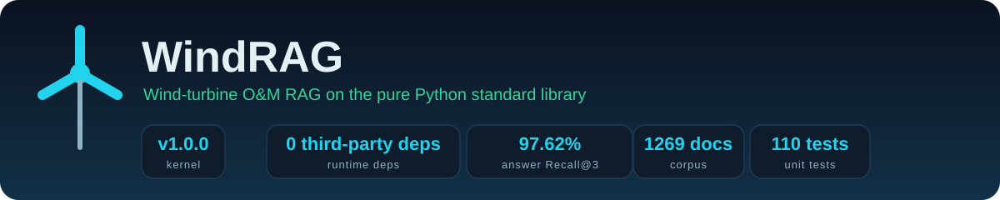

<div align="center">



[](LICENSE)


**WindRAG** — 面向风电运维知识库的轻量、纯标准库检索增强问答系统。

对话式检索 + 一个零依赖 Web 页面，渲染检索结果、来源定位与命中词。在干净解释器里用 `python` 即可直接跑通。

[功能亮点](#-功能亮点) · [快速开始](#快速开始) · [命令行](#命令行) · [Web 界面](#web-界面) · [可视化](#-可视化) · [评测与已知边界](#评测与已知边界) · [FAQ](FAQ.md)

[English](README.md)

</div>

## ✨ 功能亮点

- **零依赖** — 整条主线（`src/pure_rag/`）只用 Python 标准库；`build` / `ask` / `eval` / `serve` 在干净解释器里无需 `pip install` 即可运行。
- **混合检索** — 手写 Okapi BM25 + 稀疏 TF-IDF，用规则先验自适应 alpha 融合，再经 RRF 合并与 MMR 重排，外加基于 TF-IDF 的知识图谱上下文。
- **检索与生成分离** — 没有大模型时给出可读的抽取式答案；LLM 属可选，失败自动回退抽取式并把原因写入 `llm_error`，绝不静默降级。
- **答案可追溯** — 每条要点带回到原文的字符区间、可点击引用、故障卡片，以及命中词高亮（终端 ANSI / Web `<mark>` / Markdown 加粗）。
- **诚实评测** — 由语料自动推导、确定性构建的分层评测集；消融表如实记录负面结果，以及口语化查询的真实（明显更低的）可用率。

## 是什么 / 不是什么

| 是 | 不是 |
|---|---|
| 对话式检索问答（`ask` / `chat`） | 稠密向量语义检索（用 TF-IDF 顶替） |
| 零依赖 Web 单页渲染结果与来源 | 重前端框架（原生 HTML/CSS/JS，无 CDN） |
| 关键词 + 稀疏语义 + 规则融合重排 | 神经网络召回模型 / 训练流程 |
| 可选 LLM 增强（标准库 urllib 直连） | 必需大模型（不配也能出抽取式答案） |
| 导入自有文档（txt/md/json/csv/docx） | 在线抓取 / 数据管道 |

## 快速开始

不需要 `pip install` 任何包，也不需要大模型：

```bash
python src/rag_cli.py build                                  # 构建索引（分词 + BM25 + TF-IDF + 新词发现）
python src/rag_cli.py ask "齿轮箱温度过高应该怎么处理？" --show-docs
python src/rag_cli.py chat                                   # 交互式多轮问答
python src/rag_cli.py serve --port 8000                      # 打开 http://127.0.0.1:8000
```

检索与生成是分离的两层：不配 `LLM_API_KEY`（或设 `DISABLE_LLM=true`）时，检索照常返回文档与命中词，生成层降级为抽取式答案（`mode` 为 `extractive`），不会因缺模型而报错、卡住或返回空壳。

导入自有资料：把文件放进 `data/user_docs/` 后重新 `build`；或直接 `python src/rag_cli.py add 文件/目录` 增量入库（只对新增文档分块分词，旧文档复用持久化的词序列）。

## 命令行

入口 `python src/rag_cli.py <子命令>`，全部为真身实现：

| 子命令 | 作用 |
|---|---|
| `build` | 构建索引（分词 + BM25 + TF-IDF + 无监督新词发现） |
| `ask "<问题>" [--show-docs]` | 单次问答，`--show-docs` 附带要点在原文中的字符区间定位 |
| `chat [--log]` | 交互式多轮问答，`--log` 或 `/save` 导出带来源的 Markdown 记录 |
| `add <文件/目录>` | 增量追加文档，不重建整个索引 |
| `explain "<问题>"` | 查看每个查询词对 BM25 / TF-IDF 打分的逐项贡献 |
| `stats` | 索引统计与模型可用状态 |
| `serve --port <p>` | 启动零依赖 Web 界面 |
| `eval [-n N] [--report] [--negative] [--robust]` | 检索评测 / 分层报告 / 拒答标定 |
| `tune [--quick]` | 网格搜索分块与融合参数并落盘生效 |
| `ablation` | 消融实验表：逐项开关各模块并输出对比 |

作为库调用：

```python
import sys; sys.path.insert(0, "src")
from pure_rag import RAGEngine

engine = RAGEngine(use_llm=False)
result = engine.query("齿轮箱温度过高应该怎么处理？")
print(result["answer"])
for doc in result["retrieved_docs"]:
    print(doc["score"], doc["matched"], doc["metadata"]["title"])   # matched 为命中词
```

## Web 界面

`serve` 后打开 `http://127.0.0.1:8000`，是普通聊天机器人的样子：上方会话流、下方输入框，Enter 发送、Shift+Enter 换行，可不断追问（"那多久换一次？""它呢？"）。

- 顶栏：模型状态（已启用 / 不可用带失败原因 / 未启用）与语料规模，每轮刷新。
- 答案气泡：自然语言答案、meta 行（生成方式 / alpha / 检索方法 / 耗时 / 候选 / 图谱命中）、拒答与降级提示。
- 引用：答案里的 `[1]` `[2, 3]` 可点击，多编号会同时描边全部来源并滚到第一条。
- 折叠区：故障卡片、要点定位（点击跳原文并展示摘录）、引用来源。
- 会话：服务端按 `session_id` 存最近 8 轮做指代消解，检索层本身仍无状态。

接口路由（无框架、无 CDN，前端三个静态文件在 `src/pure_rag/web/`）：

```text
GET  /                   对话页
GET  /static/style.css   样式       GET /static/app.js   逻辑（仅白名单内文件）
POST /api/query          问答，入参 {question, top_k, method, alpha, session_id}
POST /api/session/reset  清空该会话的多轮上下文
GET  /api/stats          索引与模型状态
```

## 📊 可视化

架构、主流程、时序与数据流图均由 Archify 生成，以自包含的交互式 HTML 形式随仓库附在 [`docs/archify/`](docs/archify/)（已过 showcase 校验）。在浏览器打开，支持缩放、平移、搜索与关系追踪：

- [系统架构全景](docs/archify/architecture-panorama.html) — 全模块、分层边界、外部服务，以及主线与遗留版的划分。
- [问答主流程](docs/archify/workflow-panorama.html) — 从提问到答案的完整链路，含生成前的拒答闸门与图谱旁路。
- [/api/query 调用链](docs/archify/sequence-panorama.html) — 一次请求按时间顺序经过的全部组件。
- [数据流全景](docs/archify/dataflow-panorama.html) — 语料 -> 入库 -> 索引 -> 消费，全部可复现。

顶部横幅由 [`scripts/visualization/generate_banner.py`](scripts/visualization/generate_banner.py) 生成，运行时从真源读取版本、测试数、语料规模与 Recall，不写死任何数值。

## 当前实测数据

下表全部由脚本从真源生成，不许手写；语料或评测变化后重跑 `python src/rag_cli.py eval --report`，再 `python src/gen_readme_facts.py --readme README.zh-CN.md`（校验漂移用 `--check`）。

<!-- BEGIN AUTO:FACTS (generated by: python src/gen_readme_facts.py) -->

| 项 | 值 | 真源 |
|---|---|---|
| 内核版本 | 1.0.0 | `pure_rag.__version__` |
| 语料规模 | 1269 篇 / 1273 分块 / 词表 4179 词 （新词发现 276 个） | `data/pure_index/meta.json` |
| 知识图谱 | 162 节点 / 160 边 | `data/knowledge_graph.json` |
| 评测集 | 1473 条（8 层） | `data/eval_set.json` |
| 回答层 Recall@3 | 97.62% | `python src/rag_cli.py eval --report` |
| 口语化层 Recall@3 | 58.00%（53 条） | 同上 |
| 近邻负例拒答 | 100.00% | 同上 |
| 域外问题拒答 | 100.00% | 同上 |
| 单元测试 | 109 项 | `python -m unittest tests.test_pure_rag` |

<!-- END AUTO:FACTS -->

## 评测与已知边界

评测集由语料自动推导、确定性构建，无需人工标注（`python src/rag_cli.py eval --report` 生成 `data/pure_index/report.md`）。但要把话说清楚：

- **合成评测的高分有水分**。合成查询从文档字段派生，与答案共享风场名 / 机组号 / 故障名这些稀有词，等于"报答案找文档"，所以回答层明显高于上面实测数据块里的口语化层。用 `data/human_questions.json` 里人写的口语化提问（只描述现象、省略部件名）测，真实可用率更低。差距不在调参，在于缺少真语义表示——本内核的"向量"通道只是 TF-IDF，跨不过"嗡嗡响 vs 异响""发烫限电 vs 绕组温度"这类词汇鸿沟。复现：`python src/pure_rag/human_eval.py`（确定性）。
- **规模会推翻小语料结论**。同一套代码在小型 fixture 与规模化语料上的结论不同：当前规模化报告里仅 BM25 反而超过完整配置。查询扩展在多路召回 RRF 合并后稀释了精确匹配，已改为默认关闭。逐项开关见 `python src/rag_cli.py ablation`（含固定 alpha 扫描与负面结果，如实记录）。
- **拒答有两判据**：一是 IDF 加权查询词覆盖率（拦域外问题，实测 100%），二是知识图谱的部件×故障组合校验（拦"偏航系统制动器失效"这类词都对但不存在的伪问题，并把该故障实际所属部件指出）。
- **仍在的边界**：域内缺资料（问价格、某风场实际发电量、备件型号）覆盖率满、组合也成立，只是资料里没这条信息，当前判据识别不了。

## 可选接入大模型

生成层用标准库 `urllib` 直连 OpenAI 兼容接口，不装任何 SDK。`config.env`（已 gitignore，不入库）里几个键：

```env
LLM_PROVIDER=zhipu            # zhipu | modelscope，决定默认服务地址与免费档模型池
LLM_API_KEY=your_api_key_here
LLM_MODELS=glm-4-flash-250414:1,glm-4v-flash:3,glm-4-flash:4
DISABLE_LLM=false
```

约定：

- `LLM_MODELS` 格式为 `name:priority`，只允许账户**免费可调**的模型进池，失败自动切下一个并进入 60s 冷却，轮转位存 `data/pure_index/llm_rotation.json`。
- **评测不调模型**：`eval` / `ablation` / `tune` 默认强制抽取式，不去砸额度，也不让非确定生成污染指标。
- **降级不静默**：LLM 失败或模型池全部冷却时答案退回抽取式，并在 `llm_error` 里带回服务端原始 code/msg，命令行打 `[warn]` 行，Web 界面在答案下方显示提示。

## 设计取舍（零依赖）

`src/pure_rag/` 只用标准库实现整条链路，与重依赖研究版并存但主线不 import 后者：

| 能力 | 常依赖版 | 纯 Python 主线 |
|---|---|---|
| 中文分词 | jieba | 领域词典 + 正向最大匹配 + 二元组，可无监督发现新词 |
| 关键词检索 | rank-bm25 | 手写 Okapi BM25（倒排表 + 平滑 IDF） |
| 语义检索 | text2vec（768 维） | 手写 TF-IDF 稀疏向量 + 倒排 + 余弦相似度 |
| 融合权重 | MLP + 规则先验 | 规则先验自适应 alpha + RRF 合并 + MMR 重排 |
| 知识图谱 | embedding 余弦匹配 | TF-IDF 语义匹配 + 同义词表（"变速箱 → 齿轮箱"） |
| 答案生成 | LLM API | 抽取式摘要（默认），可选 LLM 走 urllib |
| Web 界面 | Gradio | `http.server` 对话式单页，原生 HTML/CSS/JS |
| 环境配置 | python-dotenv | 自写 `.env` 解析（`env.py`） |
| 第三方依赖 | 10+ 个包 | 0 个 |

`src/` 根目录下的 `run_rag.py`、`build_index.py`、`gradio_app.py`、`adaptive_fusion.py`、`query_features.py`、`evaluation.py`、`system_validation.py`、`ablation_experiment.py`、`generate_images.py` 等属重依赖遗留研究版，只作对照留存，不进主线、不在纯 Python 路径上被 import；新改动一律落在 `src/pure_rag/`。

## 项目结构

```text
src/
├── rag_cli.py            # 纯 Python 版命令行入口
├── gen_readme_facts.py   # README 实测数据块生成器（从真源读取，不手写）
├── simulate_corpus.py    # 规模化测试语料生成器（确定性、可复现）
└── pure_rag/             # 零依赖检索内核（主线）
    ├── text_utils.py     # 分词、新词发现、句子切分、同义词
    ├── query_analysis.py # 问题分类、自适应 alpha、查询扩展
    ├── bm25.py / tfidf.py / fusion.py / kg.py   # 检索与融合
    ├── chunker.py / loader.py                    # 分块与文档导入
    ├── generator.py      # 抽取式生成 + 可选 LLM
    ├── highlight.py      # 命中高亮（ANSI / HTML / Markdown）
    ├── datasets.py / evaluator.py / tuner.py / ablation.py / human_eval.py   # 评测
    ├── env.py / stdio.py # 配置加载 / 标准流编码加固（Windows 代码页下不中断）
    ├── engine.py / cli.py # RAGEngine 主引擎 / 子命令
    └── web/              # 对话式前端静态资源（server.py 按白名单读取）
data/
├── user_docs/            # 自有文档（txt/md/json/csv/docx，自动纳入索引）
├── synthetic/            # 合成数据 + 拒答评测集
├── pure_index/           # 纯 Python 版索引与调优参数（可重新生成，不入库）
└── generated/            # 规模化测试语料（simulate_corpus.py 生成，可重新生成）
tests/test_pure_rag.py    # 纯 Python 内核单元测试
scripts/
├── verify.mjs / release.mjs / publish-local.mjs / mirror-sync.mjs   # 发布流水线（Node 工具；主线运行时仍是纯 Python）
└── visualization/        # README 与全景页资产生成脚本（仅标准库）
    ├── generate_banner.py   # 从真源生成 docs/assets/banner.svg
    └── generate_overview.py # 从报告生成 docs/project_overview/overview-data.js
docs/
├── index.html            # GitHub Pages 入口 -> project_overview
├── project_overview/     # 交互式项目全景观览页
│   └── overview-data.js   # 从报告生成的全景页数据
├── assets/banner.svg     # 生成的横幅图（图内文字全英文）
├── project-analysis.md    # 架构与实测核对记录
└── archify/              # 交互式 架构 / 主流程 / 时序 / 数据流 HTML
.cnb.yml                  # 持续集成：单测 + 评测门禁 + 文档资产一致性
.github/workflows/        # ci.yml（PR 门禁）+ publish.yml（打 tag 出纯文本 Release）
.github/ISSUE_TEMPLATE/   # issue 与 PR 模板
hooks/                    # 提交前快门禁；启用一次：git config core.hooksPath hooks
pipeline.config.json      # 发布流水线配置（版本文件、门禁、远程、镜像同步）
Makefile                  # 目标：python rag_cli.py + verify/release/publish-local/mirror-sync
.gitattributes            # 行尾规范化 + linguist 归类
README.md / README.zh-CN.md          # 英文主版 + 中文配套版
CONTRIBUTING.md / CONTRIBUTING.zh-CN.md
CHANGELOG.md / FAQ.md / SECURITY.md / AUTHORS / LICENSE
```

复现本文评测所依据的规模化语料与指标：

```bash
python src/simulate_corpus.py        # 确定性生成规模化测试语料
python src/rag_cli.py build
python src/rag_cli.py eval --report
python src/rag_cli.py ablation
python src/gen_readme_facts.py       # 刷新 README 实测数据块
python scripts/visualization/generate_overview.py # 刷新全景页数据
```

> 语料保真度说明：风场名取自公开数据集 OpenWindSCADA 收录的真实场站，机型用真实型号命名，部件 / 故障词表沿用项目知识图谱；其余（机组编号、时间、症状、停机时长、数字）均为模板生成，不是实测分布。它的作用是把样本量做够、把语料做出干扰，不是当真实数据使用。

## 贡献、许可证与联系方式

- 仓库：[GitHub](https://github.com/LPK3215/WindRAG)（origin）— 同步镜像到 [Gitee](https://gitee.com/LPK-Gitee/WindRAG) 与 [CNB](https://cnb.cool/lpk3215/WindRAG)，三端均跟踪 `main`。
- 贡献：见 [CONTRIBUTING.md](CONTRIBUTING.zh-CN.md)；变更历史见 [CHANGELOG.md](CHANGELOG.md)；常见问题见 [FAQ.md](FAQ.md)；漏洞报告见 [SECURITY.md](SECURITY.md)。
- 作者与维护者：见 [AUTHORS](AUTHORS)。维护者：**LPK3215** <17538703215@163.com>。
- 许可证：基于 [MIT License](LICENSE) 开源，© 2026 LPK3215 and WindRAG contributors。
